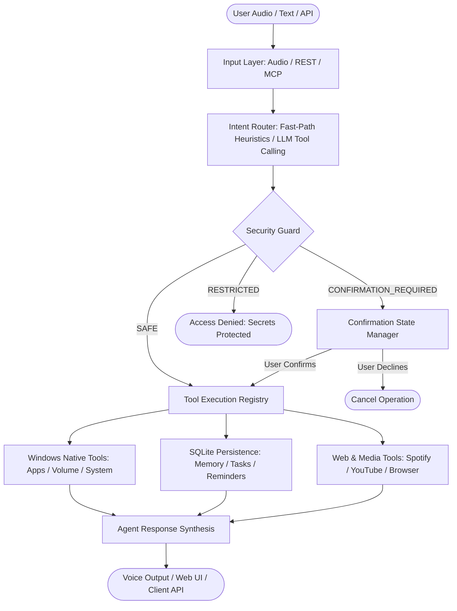

# DADUS: Desktop AI Assistant & Automation Agent

[](https://www.python.org/downloads/)
[](https://www.microsoft.com/windows/)
[](https://fastapi.tiangolo.com)
[](https://opensource.org/licenses/MIT)

DADUS is a desktop AI operating assistant for Windows that integrates natural voice processing, application automation, system controls, and contextual task memory. It operates completely offline out-of-the-box using local speech synthesis and deterministic intent routing, with optional OpenAI-compatible LLM tool calling and Model Context Protocol (MCP) server support.

---

## Architecture Overview

DADUS separates speech perception, intent resolution, security evaluation, and native desktop execution into decoupled layers:



---

## Core Capabilities

- **Desktop Application Lifecycle:** Dynamically resolves installed software across the Windows Registry, Start Menu (`.lnk`), and system `PATH` with caching to launch and manage applications.
- **Audio & Media Control:** Native Windows master volume control (0-100% and incremental adjustments) via `pycaw`, system audio ducking during speech recognition, and media player integration (Spotify, YouTube).
- **Multi-Tier Security Enforcement:**
  - **`SAFE`:** Non-destructive actions execute immediately (app launch, volume control, status checks).
  - **`CONFIRMATION_REQUIRED`:** Potentially destructive operations (file deletion, system shutdown) pause and require affirmative user consent before execution.
  - **`RESTRICTED`:** System-level secret queries (passwords, auth tokens, banking credentials) are intercepted and rejected at the code level.
- **Persistent Memory & Task Management:** SQLite database layer tracking user preferences, natural-language reminders, daily schedules, and conversation context.
- **Zero-Latency Offline Voice Pipeline:**
  - **TTS:** Windows native `SAPI.SpVoice` for zero-latency, offline text-to-speech without cloud API fees.
  - **STT:** Local speech recognition with background ambient noise calibration and conversational pause thresholding.
  - **Wake Word:** Background detection for `"Hey Dadus"` with audio ducking and lock-screen awareness.
- **Model Context Protocol (MCP) Server:** Fully compliant JSON-RPC 2.0 MCP server exposing tools over stdio and HTTP.

---

## Project Structure

```
DADUS/
├── app/
│   ├── main.py                  # CLI, Voice daemon, and Server entry points
│   ├── agent/
│   │   ├── agent.py             # Core agent coordinator & session state
│   │   ├── router.py            # Intent classification & tool dispatch
│   │   ├── planner.py           # Multi-step task decomposition
│   │   ├── prompts.py           # Agent persona and system prompts
│   │   └── state.py             # Session and conversation data models
│   ├── api/
│   │   └── server.py            # FastAPI REST endpoints & WebSocket feeds
│   ├── audio/
│   │   └── ducking.py           # Windows hardware audio ducking
│   ├── config/
│   │   └── settings.py          # Environment settings & Pydantic config
│   ├── database/
│   │   ├── database.py          # SQLAlchemy SQLite connection session
│   │   └── models.py            # ORM models (Memory, Tasks, Reminders, Audit)
│   ├── devices/
│   │   └── device_manager.py    # Client endpoint & capability registry
│   ├── mcp/
│   │   ├── server.py            # Model Context Protocol JSON-RPC server
│   │   └── client.py            # Programmatic MCP client
│   ├── security/
│   │   ├── permissions.py       # 3-tier permission validator & query sanitizer
│   │   ├── confirmations.py     # Pending action confirmation manager
│   │   ├── lock_screen.py       # Workstation lock-state restriction logic
│   │   └── identity.py          # User authentication and identity validation
│   ├── system/
│   │   ├── hotkey.py            # Global keyboard shortcut listener
│   │   └── tray.py              # Windows system tray integration
│   ├── tools/                   # Native automation tool implementations
│   │   ├── apps.py              # Windows Registry & Start Menu application indexer
│   │   ├── system.py            # Hardware diagnostics, volume, screenshots
│   │   ├── music.py             # Spotify & YouTube routing
│   │   ├── tasks.py             # Productivity task tracker
│   │   ├── reminders.py         # Time-based reminder scheduler
│   │   ├── files.py             # File search and management
│   │   └── registry.py          # Central tool registry and schema exporter
│   ├── ui/
│   │   ├── web_ui.py            # Local web server runner
│   │   └── static/              # Web UI, 3D WebGL visualizer, and dashboard
│   └── voice/
│       ├── stt.py               # Speech-to-text engine abstractions
│       ├── tts.py               # Native Windows SAPI & cloud TTS providers
│       └── wakeword.py          # Wake-word detection engine
├── tests/                       # Automated pytest test suite
├── data/                        # Persistent SQLite database, logs, and artifacts
├── run.py                       # Unified command-line runner
└── requirements.txt             # Project dependencies
```

---

## Installation & Setup

### Prerequisites
- **Operating System:** Windows 10 or Windows 11 (64-bit)
- **Python:** Python 3.10 or higher
- **Audio Hardware:** Working microphone and speaker for voice operations

### Setup Steps

1. **Clone the repository and enter directory:**
   ```powershell
   git clone <repo-url>
   cd "Dadus AI Agent"
   ```

2. **Create and activate a virtual environment:**
   ```powershell
   python -m venv venv
   .\venv\Scripts\Activate.ps1
   ```

3. **Install dependencies:**
   ```powershell
   pip install -r requirements.txt
   ```

4. **Configure environment settings:**
   Copy `.env.example` to `.env`:
   ```powershell
   Copy-Item .env.example .env
   ```

---

## Configuration Reference

Edit `.env` to configure assistant behavior:

| Setting | Default | Description |
|---|---|---|
| `OPENAI_API_KEY` | `""` | Optional API key for LLM tool calling (OpenAI, Groq, Ollama). |
| `OPENAI_BASE_URL` | `https://api.openai.com/v1` | Base URL for LLM provider. |
| `LLM_MODEL` | `gpt-4o-mini` | Target language model name. |
| `TTS_PROVIDER` | `sapi` | Text-to-speech backend (`sapi` for local Windows, `openai` for cloud). |
| `TTS_ENABLED` | `true` | Enable or disable voice synthesis output. |
| `STT_PROVIDER` | `speech_recognition` | Speech recognition provider. |
| `WAKE_PHRASE` | `hey dadus` | Trigger phrase for background voice detection. |
| `DATA_DIR` | `./data` | Directory for SQLite database, logs, and temporary files. |

> **Offline Operation:** If `OPENAI_API_KEY` is not provided or set to a placeholder, DADUS automatically runs using its internal heuristic parser and local Windows voice engine with zero external dependencies.

---

## Running the Application

### ⚡ One-Click Windows Launcher (Quickest)
Double-click `start_dadus.bat` or execute in command prompt:
```cmd
start_dadus.bat
```
This verifies your environment, activates your Python virtual environment, checks core dependencies, and launches the DADUS Web Dashboard on `http://127.0.0.1:8000`.

### 1. Web Dashboard (Default)
Starts the FastAPI server and opens the web control panel in your default browser:
```powershell
python run.py
```
Default URL: `http://127.0.0.1:8000`

### 2. Continuous Voice Daemon
Runs the background listener for wake-word activation (`"Hey Dadus"`):
```powershell
python run.py --voice
```

### 3. Terminal CLI Mode
Runs an interactive read-eval-print loop with voice feedback:
```powershell
python run.py --cli
```

### 4. Model Context Protocol (MCP) Server
Starts the standards-compliant MCP server over standard I/O for integration with external developer tools:
```powershell
python -m app.mcp.server
```

---

## Security Architecture

DADUS implements strict programmatic boundaries to ensure system safety:

1. **Three-Tier Permission Enforcement:**
   - Evaluated before tool execution in `app/security/permissions.py`.
   - Tool execution metadata defines whether an action is `SAFE`, `CONFIRMATION_REQUIRED`, or `RESTRICTED`.
2. **Workstation Lock Detection:**
   - Uses the Windows `User32` API to check workstation lock state.
   - Restricts desktop-modifying tools when the workstation is locked.
3. **Sensitive Data Redaction:**
   - Audit logging automatically masks API keys, auth tokens, and credentials before writing to persistent storage.

---

## Testing

The test suite validates agent intent routing, safety barriers, SQLite persistence, and Windows system integrations:

```powershell
pytest -v
```

The automated test suite covers:
- Intent classification and tool parameter extraction.
- Disambiguation workflows and user preference learning.
- Two-phase confirmation handling for destructive actions.
- Hardcoded credential query rejection and security policy enforcement.
- Hardware audio volume adjustments, muting, and ducking.
- Model Context Protocol (MCP) JSON-RPC protocol compliance.
- FastAPI REST endpoints and database models.

---

## License

This project is licensed under the MIT License.
